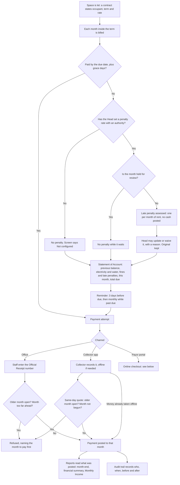
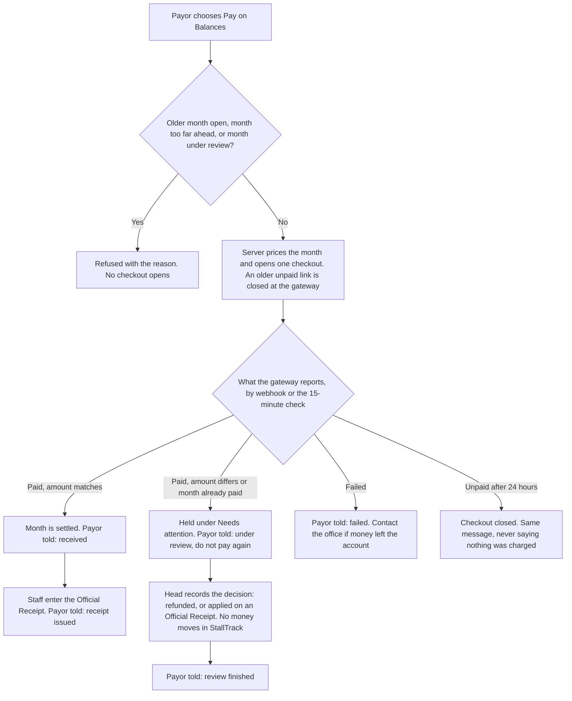

# How a month of rent moves through StallTrack

Drawn from the implemented system for monthly-rent spaces. Day-billed market rent follows the same collection and report steps, but it is priced by day and has no due date or late penalty.

The rules shown are **StallTrack Rules** each office's Head can change (IA-071, IA-072), not MEEDO rulings.

## From billing to reports

## An online payment

## Boundaries

- A due date drives display, reminders and penalties. It does not redefine Delinquent or Arrears (IA-019, IA-020, IA-069).
- A new or changed rule applies from its effective date forward. Posted collections and past months are not recalculated.
- Oldest-first stops at any month held for review, and works per occupancy, never across different occupants. It starts at the month the office counts unpaid rent from (IA-075).
- A month with no record is owed at its term's rate (IA-077). Rent already Arrears on the day it is paid reports on the Monthly Income's Arrears line, and the total does not change (IA-076).
- Pay-ahead from the office is one receipt over several separately recorded months.
- A collector cannot take rent ahead. Pay-ahead is at the office or, one month at a time, on the portal.
